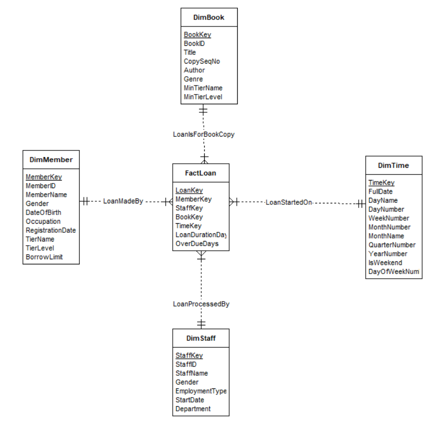
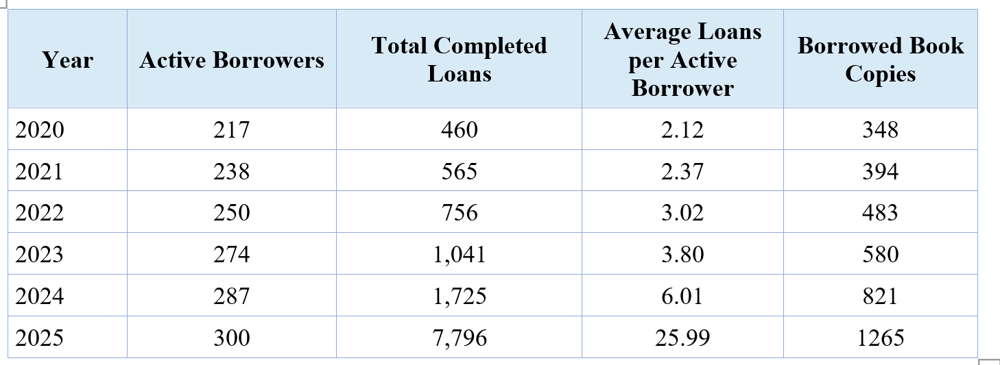
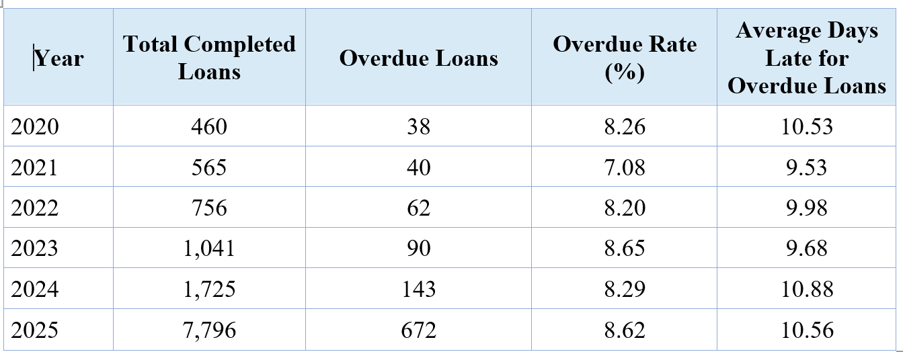
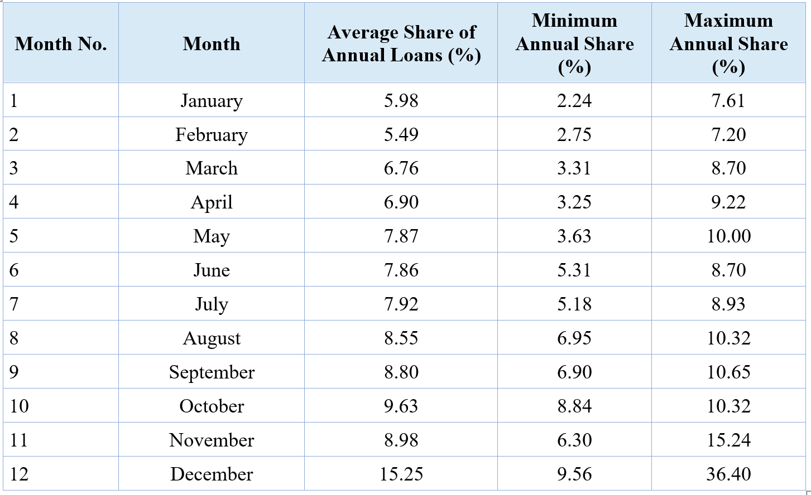
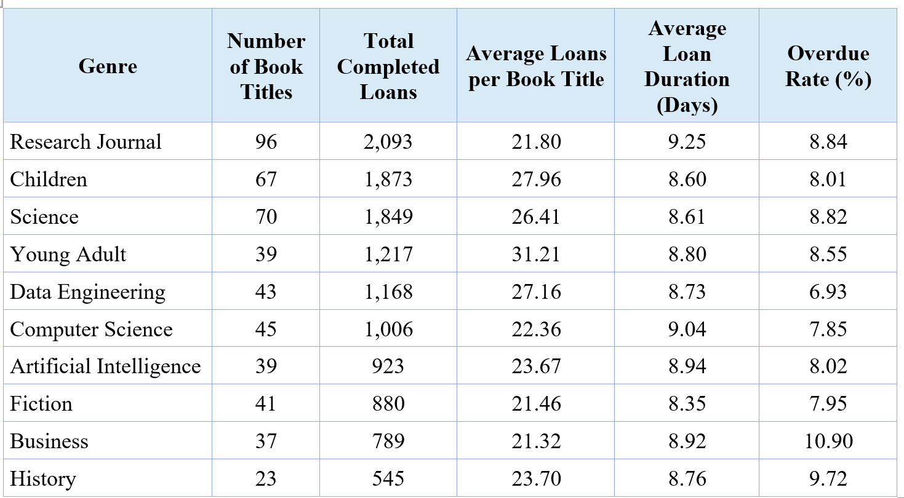
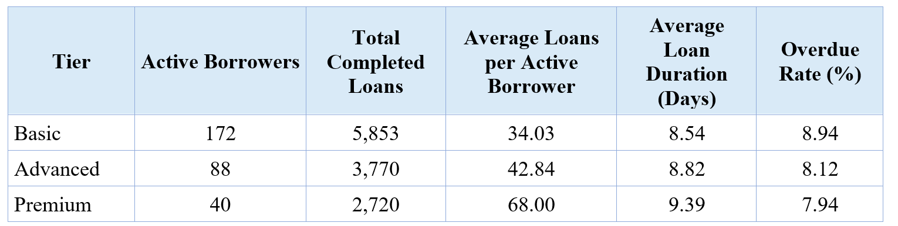
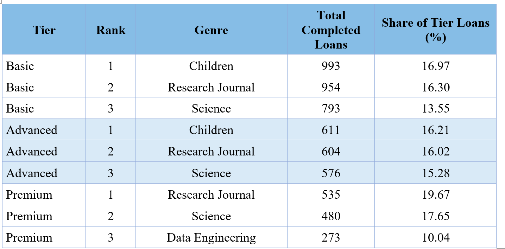
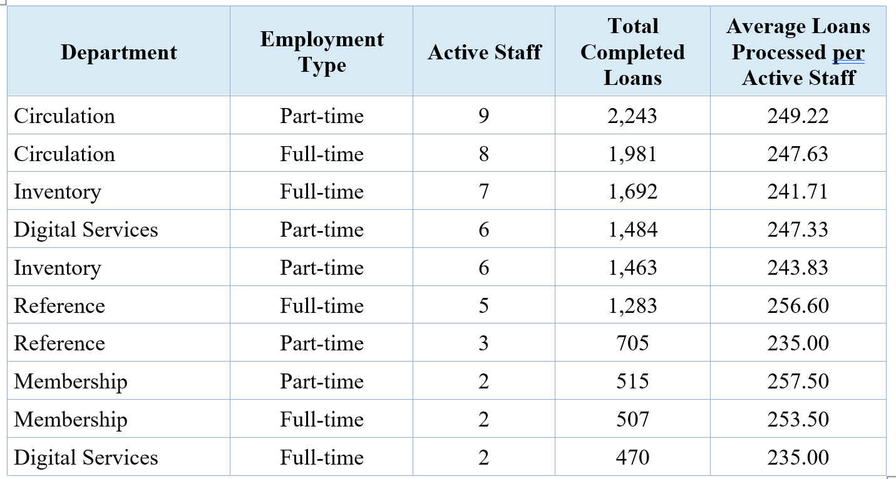
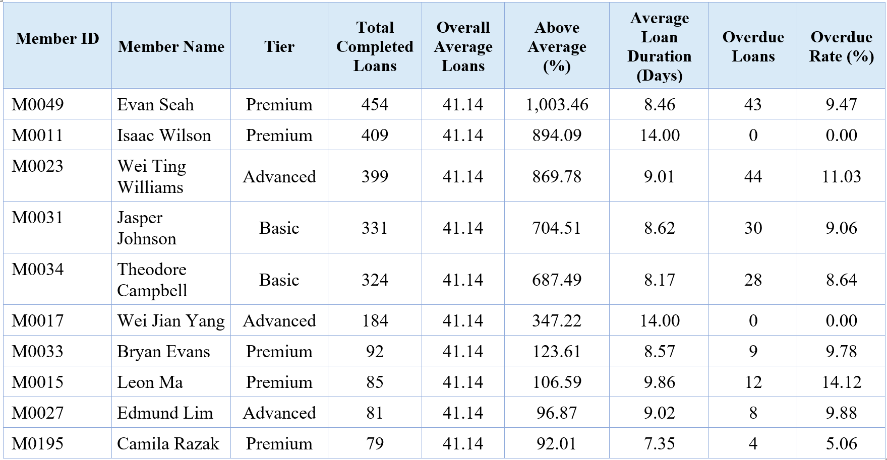

# Library Data Warehouse and Borrowing Analytics (SQL)

An end-to-end data engineering project that cleans historical library loan records, loads them into an operational (OLTP) database, transforms them into a star-schema data warehouse in MySQL, and runs analytical SQL queries to support library planning and decision-making.

**Pipeline:** OLTP source data → Data cleaning → OLTP database → Star-schema data warehouse → Analytical queries

The repository also includes two individual extensions: a **MySQL-to-MongoDB migration** and a **research study on preventing concurrent loans with row-level locking**.

---

## Project Overview

| | |
|---|---|
| **Type** | Data engineering and analytics (team project, 4 members) |
| **Database** | MySQL |
| **Data volume** | 12,344 loans, 301 members, 51 staff, 500 books, 1,265 physical copies |
| **Goal** | Turn historical loan records into insights for collection planning, member management and operations |

The analysis focuses on four areas:

- **Borrowing trends:** annual volume and monthly seasonality
- **Collection insights:** genre popularity and borrowing intensity
- **Member behaviour:** borrowing and overdue patterns by membership tier
- **Operational insights:** overdue workload and staff processing volume

---

## My Contributions

| Area | Type | Description |
|---|---|---|
| Library data warehouse | Team | Data cleaning, OLTP load, star-schema design, ETL and analytical queries (Sections 1 to 5) |
| MongoDB migration | **Individual** | Extracted book data from the OLTP database with SQL and queried it in MongoDB ([`mongodb/`](mongodb/)) |
| Concurrency research | **Individual** | 4 experiments on MySQL transactions, row-level locking and deadlocks ([`research-concurrency/`](research-concurrency/)) |

---

## Tech Stack

MySQL, SQL (DDL, DML, joins, subqueries, aggregations, transactions, locking), MongoDB (queries and aggregation pipelines), Excel (data cleaning), data visualisation

---

## 1. Data Quality and Cleaning

Eleven data quality issues were found across four categories before loading. Left unfixed, they could break data consistency, referential integrity and the OLTP load.

| Category | Issues Found |
|---|---|
| Structural / schema issues | 4 |
| Invalid values | 3 |
| Format inconsistencies | 2 |
| Cross-table / status issues | 2 |

### Issues and Resolutions

| Source | Problem Identified | Resolution |
|---|---|---|
| Members | ContactNo and Email could not both fit the single OLTP `Contact` field | Kept Email as the primary contact value |
| Members | Invalid TierID; Gender and StartDatetime formats did not match the target schema | Corrected TierID, converted gender to M/F, kept the date only |
| Loans | Summary columns were mixed in with the transactions; six "Returned" values were misaligned | Removed the summary columns (L–N) and moved the values back to `LoanStatus` |
| Loans | One record had an invalid StaffID, book copy and due date | Deleted the record, because the correct values could not be reliably recovered |
| BookCopies | "Available" was misspelled ("Availble"); one active copy was marked Available | Corrected the spelling and changed the active copy to On Loan |
| Staff | Gender and StartDatetime formats did not match the target schema | Converted gender to M/F and kept only the start date |

---

## 2. OLTP Implementation and Validation

| Table | Rows Loaded |
|---|---|
| MembershipTier | 4 |
| Member | 301 |
| Staff | 51 |
| Book | 500 |
| BookCopy | 1,265 |
| Loan | 12,344 |

**Validation checks:**
- Record counts matched the cleaned source data
- All primary-key and foreign-key relationships were valid
- Active-loan status was consistent with the BookCopy table

---

## 3. Data Warehouse Design

### Star Schema



`FactLoan` sits at the centre and links to four dimensions: `DimMember`, `DimBook`, `DimStaff` and `DimTime`.

**Grain:** one FactLoan row = one completed loan transaction for one physical book copy.

| Measure | Definition | Purpose |
|---|---|---|
| `LoanDurationDay` | Return date − start date | Borrowing duration |
| `OverDueDays` | Return date − due date (minimum 0) | Overdue severity |
| `COUNT(*)` | Number of fact rows | Completed loan volume |

**Key design decisions:**
- **Star schema:** FactLoan connects directly to four dimensions, which keeps analytical queries simple.
- **Physical-copy level:** `DimBook` uses `BookID` + `CopySeqNo` to identify each physical copy.
- **Time dimension:** `TimeKey` represents the loan start date, which supports trend and seasonality analysis.
- **No extra tier dimension:** membership-tier attributes are stored in the existing dimensions.
- **Completed loans only:** only loans with a return date are loaded, so every row has a complete duration and overdue value.
- **Surrogate keys:** simple integer keys link the fact table to each dimension.

---

## 4. ETL and Validation

- Dimension tables were loaded before `FactLoan` to maintain referential integrity.
- Only completed loans were loaded (`ReturnDatetime IS NOT NULL`).
- **Reconciliation:** completed loans in the OLTP database matched the rows in `FactLoan` exactly (**12,343 = 12,343**).
- **Additional checks:** no negative measures, no missing dimension references, and matching date ranges between OLTP and the warehouse.

| Warehouse Table | Rows Loaded |
|---|---|
| DimMember | 301 |
| DimBook | 1,265 |
| DimStaff | 51 |
| DimTime | 1,590 |
| FactLoan | 12,343 |

---

## 5. Analysis and Key Findings

| # | Analysis | Key Finding |
|---|---|---|
| A1 | Annual loan volume | From 2024 to 2025, active borrowers grew only **4.53%**, while loans per borrower rose **332.36%**. Growth came from borrowing frequency, not new borrowers. |
| A2 | Overdue frequency and severity | The overdue rate stayed stable at **7.08%–8.65%**, and average lateness stayed at **9.53–10.88 days** as volume grew. |
| A3 | Monthly seasonality | Borrowing peaks in **Q4**. December has the highest average but varies most; October is the most consistently busy month. |
| A4 | Genre popularity | After adjusting for collection size, **Young Adult** had the highest intensity at **31.21 loans per title**. |
| A5 | Membership tiers | **Premium** members borrowed most per person (**68.0 loans**) and had the lowest overdue rate (**7.94%**). |
| A6 | Genres by tier | About **47%** of each tier's loans came from its top 3 genres. Premium's top 3 included Data Engineering. |
| A7 | Staff workload | Normalised workload was similar across departments (**235–257.5 loans per active staff**). |
| A8 | Highly active borrowers | The top 10 borrowers (**3.33%** of borrowers) generated **19.75%** of all completed loans. |

All findings describe associations, not causation.

---

### A1: Annual Loan Volume and Associated Factors

**Objective:** identify whether changes in loan volume were driven more by the number of borrowers, how often they borrowed, or how many physical copies were used.



- Completed loan volume grew substantially, with the largest rise in 2025 (1,725 to 7,796 loans).
- From 2024 to 2025, active borrowers increased by only **4.53%**, while average loans per active borrower increased by **332.36%**.
- The 2025 increase was therefore driven far more by **borrowing frequency** than by growth in the number of borrowers.
- The number of borrowed physical copies also rose, from 821 to 1,265, showing wider use of the inventory.

### A2: Annual Overdue Frequency and Severity

**Objective:** assess whether the growth in loan volume came with more frequent or more severe overdue returns.



- The number of overdue loans rose with overall volume, from 38 in 2020 to 672 in 2025.
- However, the **overdue rate stayed stable at 7.08% to 8.65%**.
- Average lateness also stayed in a narrow range of **9.53 to 10.88 days**.
- Higher borrowing activity did **not** lead to worse return behaviour. However, more transactions still mean a larger absolute workload for reminders and follow-ups.

### A3: Normalised Monthly Borrowing Seasonality

**Objective:** identify recurring monthly borrowing patterns after adjusting for differences in annual volume. Each month is expressed as its share of that year's loans.



- Borrowing is generally stronger towards the end of the year, especially in **Q4**.
- **December** has the highest average share (15.25%), but it is also the most variable month, ranging from 9.56% to 36.40% across years.
- **October** (9.63%) is a more **consistently** high-borrowing month than December.
- The library should plan for heavier circulation in Q4, without assuming that every December will peak.

### A4: Genre Popularity and Borrowing Behaviour

**Objective:** compare genre demand using both total loans and loans per title, and examine loan duration and overdue behaviour by genre.



- **Research Journal** had the highest total loans (2,093), but it also has the most titles (96), so collection size inflated its total.
- After adjusting for collection size, **Young Adult** had the highest borrowing intensity at **31.21 loans per title**.
- Average loan duration was similar across genres (8.35 to 9.25 days).
- Overdue rates varied more: **Business** was highest (10.90%) and **Data Engineering** lowest (6.93%).

### A5: Membership-Tier Borrowing and Overdue Behaviour

**Objective:** compare borrowing intensity and return behaviour across the Basic, Advanced and Premium tiers.



- **Basic** had the highest total loans (5,853), because it has the most active borrowers (172).
- **Premium** had the highest borrowing intensity at **68.00 loans per active borrower**, twice the Basic rate.
- Premium also had the **lowest overdue rate (7.94%)**, while Basic had the highest (8.94%).

### A6: Genre Borrowing Patterns by Membership Tier

**Objective:** compare the leading genres within each membership tier.



- Basic and Advanced share the same top 3 genres: **Children, Research Journal and Science**.
- Premium shows a different pattern, led by Research Journal and Science, with **Data Engineering** in its top 3.
- Around **47%** of each tier's loans come from its top 3 genres.
- These patterns may reflect both borrower interests and tier-based access restrictions.

### A7: Staff Workload by Department

**Objective:** compare loan-processing workload across departments after adjusting for the number of active staff.



- **Circulation (part-time)** processed the highest total volume: **2,243 loans**.
- After adjusting for staff count, **Membership (part-time)** had the highest average at **257.50 loans per active staff member**.
- Group averages were close (235.00 to 257.50), which suggests a fairly even processing workload.
- These figures measure transaction volume, not staff productivity.

### A8: Highly Active Borrowers

**Objective:** identify the most active borrowers and compare their borrowing volume with their return behaviour.



- The **top 10 borrowers** make up only **3.33%** of active borrowers but generated **19.75%** of all completed loans.
- High borrowing activity does **not** consistently mean more overdue loans. Some of the most active borrowers had zero overdue loans, while others had noticeably higher overdue rates.
- Borrowing activity and overdue behaviour should therefore be assessed **separately**, and reminders should target overdue patterns rather than borrowing frequency.

---

## 6. MongoDB Migration (Individual)

Book data was extracted from the OLTP database into a document format and loaded into a MongoDB `Book` collection (**500 documents**).

- **SQL extract** ([`mongodb/book_extract.sql`](mongodb/book_extract.sql)): joins `Book`, `MembershipTier`, `BookCopy` and a loan-count subquery so that each document holds a book's details, minimum membership tier, total and lost copies, and total loans.
- **MongoDB queries** ([`mongodb/book_queries.js`](mongodb/book_queries.js)):
  - `find()` with a filter, projection and sort to list books with more than 400 loans
  - an aggregation pipeline (`$group`, `$match`, `$project`, `$sort`) to find genres with more than 50 books and an average of more than 70 loans per book

---

## 7. Research: Preventing Concurrent Loans with Row-Level Locking (Individual)

An individual study on how MySQL transactions and `SELECT ... FOR UPDATE` stop two members from borrowing the same physical copy at the same time. It covers four controlled experiments: a race condition, lock waiting, rollback recovery and deadlock detection.

| Experiment | Result |
|---|---|
| Unprotected reads | 2 conflicting active loans for one copy |
| `SELECT ... FOR UPDATE` | Second session blocked, then rejected; 1 active loan |
| `ROLLBACK` | All uncommitted changes reversed |
| Reversed lock order | Deadlock detected by InnoDB (error 1213) |

Full write-up: [`research-concurrency/README.md`](research-concurrency/README.md)

---

## Recommendations

- **Plan for Q4:** prepare staffing and circulation capacity for heavier borrowing towards the end of the year.
- **Plan reminder capacity:** overdue rates are stable, but rising loan volume still increases the absolute follow-up workload.
- **Use per-title metrics for collection decisions:** total loans favour genres with many titles, while loans per title show true demand.
- **Target overdue reminders by behaviour:** high borrowing activity does not predict late returns, so overdue patterns should be tracked separately.

---

## Repository Structure

```
├── sql/                          # Team: OLTP and data warehouse
│   ├── OLTP_insert.sql           # Cleaned source data loaded into the OLTP database
│   ├── DW_create.sql             # Star-schema DDL (dimension and fact tables)
│   ├── DW_insert.sql             # ETL: OLTP → dimensions → FactLoan
│   └── DW_query.sql              # Analytical queries (A1–A8)
├── mongodb/                      # Individual: MongoDB migration
│   ├── book_extract.sql
│   └── book_queries.js
├── research-concurrency/         # Individual: locking and transactions study
│   ├── README.md
│   └── figures/
├── images/                       # Star schema diagram and analysis result tables (A1–A8)
├── Library_DW_Slides.pdf         # Presentation slides
└── README.md
```

---

## How to Run

1. Install **MySQL 8.0** or later, plus MySQL Workbench or another SQL client.
2. Run the scripts in this order:

```sql
SOURCE sql/OLTP_insert.sql;   -- 1. Build and load the OLTP database
SOURCE sql/DW_create.sql;     -- 2. Create the star-schema warehouse
SOURCE sql/DW_insert.sql;     -- 3. Load dimensions, then FactLoan
SOURCE sql/DW_query.sql;      -- 4. Run the analytical queries
```

---

## Team

The data warehouse (Sections 1 to 5) was developed as a team project for the Data Engineering module at Singapore Polytechnic by Phyu Sin Lynn, Thawdar Lin Wai, Toh Ke Ting and Eaint Chu Nay Chi. Sections 6 and 7 are individual work by Thawdar Lin Wai.
