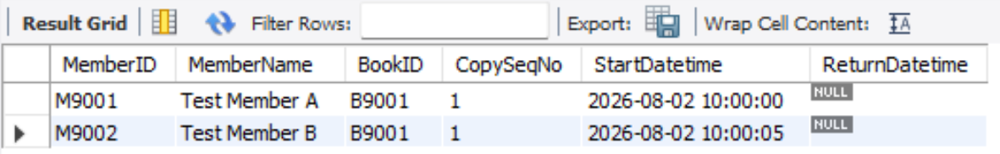
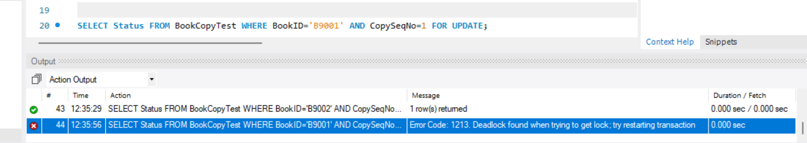

# Preventing Concurrent Loans with MySQL Transactions and Row-Level Locking

**Individual research study.** This study investigates how MySQL transactions and InnoDB row-level locking prevent two library members from borrowing the same physical book copy at the same time.

**Research question:** How do MySQL transactions and row-level locking prevent two members from concurrently borrowing the same physical library book copy?

---

## The Problem

Suppose two staff members try to loan the same physical book copy to different members at the same moment. If both processes check availability *before* either one updates the database, both see the copy as **Available**, and the system creates two conflicting active loans.

A regular `SELECT` cannot protect this read-then-update process. The library's table keys cannot stop it either. The `Loan` primary key includes `MemberID`, `BookID`, `CopySeqNo` and `StartDatetime`, so two different members produce two different, valid keys for the same copy.

---

## Approach

Four controlled experiments were run using **two independent MySQL Workbench sessions** to simulate two staff members working at the same time.

| Setting | Value |
|---|---|
| Database engine | MySQL 8.0, InnoDB |
| Isolation level | REPEATABLE READ (default) |
| Test database | `CA2PartF_Locking`, separate from the project database |
| Physical copy | `B9001`, copy 1 (initially Available) |
| Competing members | `M9001` and `M9002` |
| Copy identifier | Composite key `(BookID, CopySeqNo)` |

---

## Experiments and Results

### Experiment 1: Unsafe borrowing without a locking read

Both sessions read the copy's status with a normal `SELECT`. Both saw **Available**, and both inserted a loan.



**Result:** **2 active loans** for the same physical copy. MySQL raised no error. The invalid state came entirely from stale availability information.

### Experiment 2: Borrowing with `SELECT ... FOR UPDATE`

Session A locked the copy's row with `SELECT ... FOR UPDATE`. When Session B ran the same query, it was **blocked** until Session A committed. Session B then read the latest status, **On Loan**, and rejected the request.


**Result:** Session B waited **18.1 seconds** for the lock, and the final state had exactly **1 active loan**.

### Experiment 3: Failure recovery with `ROLLBACK`

Session A locked the copy, inserted a loan and changed the status to On Loan. A failure was then simulated with `ROLLBACK` before the commit.


**Result:** the copy returned to **Available** with **0 active loans**. The insert and the status update were reversed together.

### Experiment 4: Deadlock from reversed lock order

Two copies were locked in **opposite orders** by the two sessions: A locked B9001 then B9002, while B locked B9002 then B9001. This created a circular wait.



**Result:** InnoDB detected the deadlock (**error 1213**), chose Session B as the victim and rolled it back automatically, which let Session A continue.

### Summary

| Experiment | Observed Result | Meaning |
|---|---|---|
| Normal `SELECT` | 2 active loans | Both sessions acted on the same stale status |
| `FOR UPDATE` wait | 18.1 s lock wait | Session B was blocked until Session A released the lock |
| Protected final state | 1 active loan | Session B re-read the status as On Loan and rejected the request |
| `ROLLBACK` | Available, 0 active loans | All uncommitted changes were reversed together |
| Reversed lock order | Error 1213 | InnoDB detected and resolved the deadlock |

---

## Recommended Borrowing Pattern

```sql
START TRANSACTION;

SELECT Status
FROM BookCopy
WHERE BookID = ? AND CopySeqNo = ?
FOR UPDATE;                        -- lock the physical copy

-- If Status = 'Available':
--     INSERT the Loan and UPDATE BookCopy SET Status = 'On Loan'
--     COMMIT;
-- Otherwise:
--     ROLLBACK;
```

**Design notes:**
- **Lock, then re-check.** The lock alone is not enough. The application must re-check the returned status before inserting the loan.
- **Use `FOR UPDATE`, not `FOR SHARE`.** Shared locks let both sessions read Available, which can lead to a lock-upgrade deadlock.
- **Index the lookup.** The composite key `(BookID, CopySeqNo)` lets InnoDB lock only the target row instead of scanning and locking a wider range.
- **Lock in a consistent order.** For multi-row operations, always lock rows in the same order (for example, by `BookID`, then `CopySeqNo`) and keep transactions short.
- **Handle deadlocks.** Applications must catch error 1213 and retry the rolled-back transaction.
- **Pessimistic over optimistic locking here.** Optimistic locking with version numbers is an alternative. Pessimistic locking fits this case better, because assigning one copy to two members is a serious business error and loan transactions are short.

---

## Limitations

- Only two concurrent sessions were tested. Experiments 1 to 3 used a single row, and Experiment 4 used two rows.
- Heavy concurrent workloads, other isolation levels and automatic retry logic were not tested.
- Lock-wait times reflect when the manual commit happened, not database performance.

---

## Conclusion

Primary-key constraints alone cannot stop one physical copy from being loaned to two members. A locking read closes that gap: it forces the second transaction to wait and then re-check the latest committed status. `ROLLBACK` safely reverses incomplete operations, and the deadlock experiment shows why a consistent lock order and short transactions matter once more than one row is involved.

---

## References

- MySQL. *InnoDB Locking Reads*. MySQL 8.4 Reference Manual. https://dev.mysql.com/doc/refman/8.4/en/innodb-locking-reads.html
- MySQL. *START TRANSACTION, COMMIT, and ROLLBACK Statements*. MySQL 8.0 Reference Manual. https://dev.mysql.com/doc/refman/8.0/en/commit.html
- MySQL. *InnoDB Lock and Lock-Wait Information*. MySQL 8.4 Reference Manual. https://dev.mysql.com/doc/refman/8.4/en/innodb-information-schema-understanding-innodb-locking.html

---

**Author:** Thawdar Lin Wai, Diploma in Applied AI and Analytics, Singapore Polytechnic
